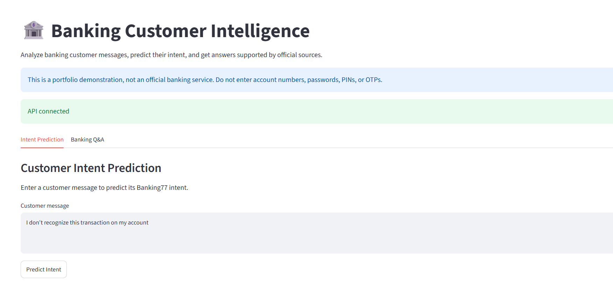
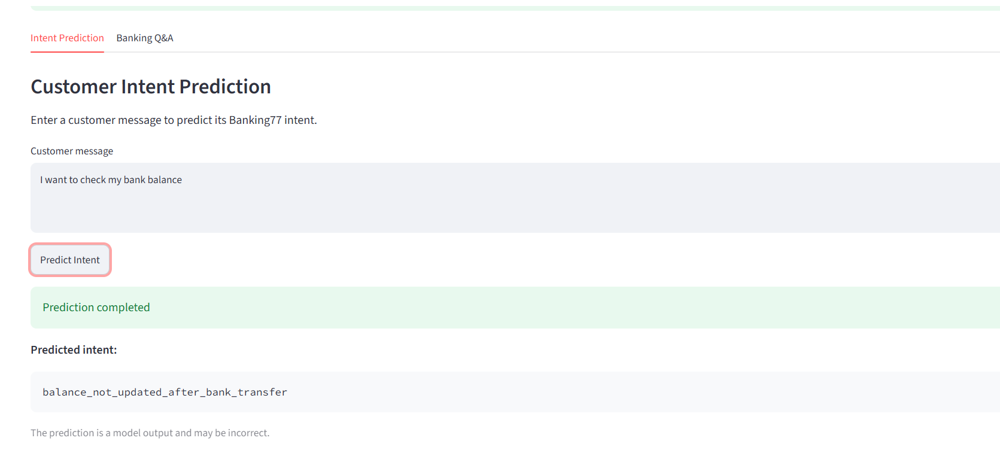
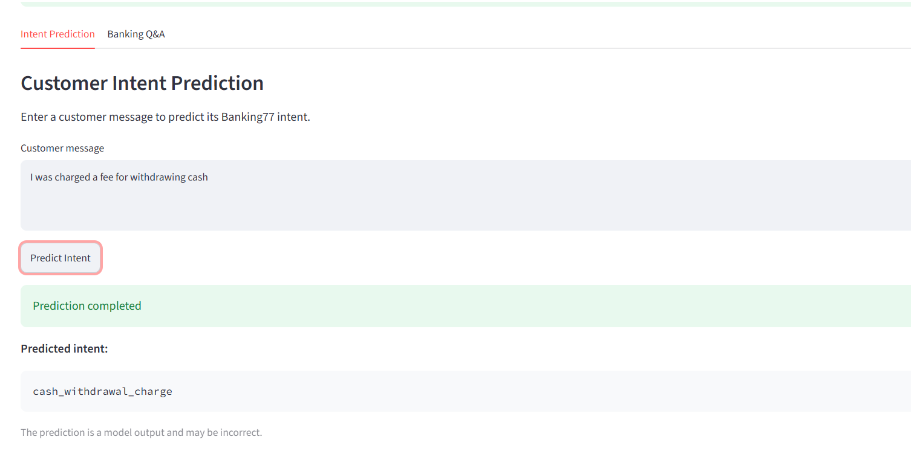
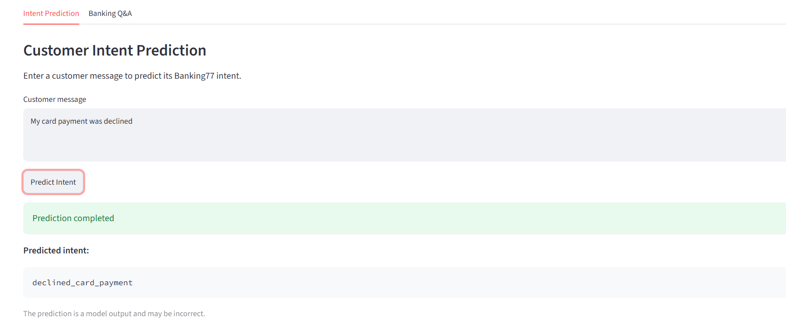
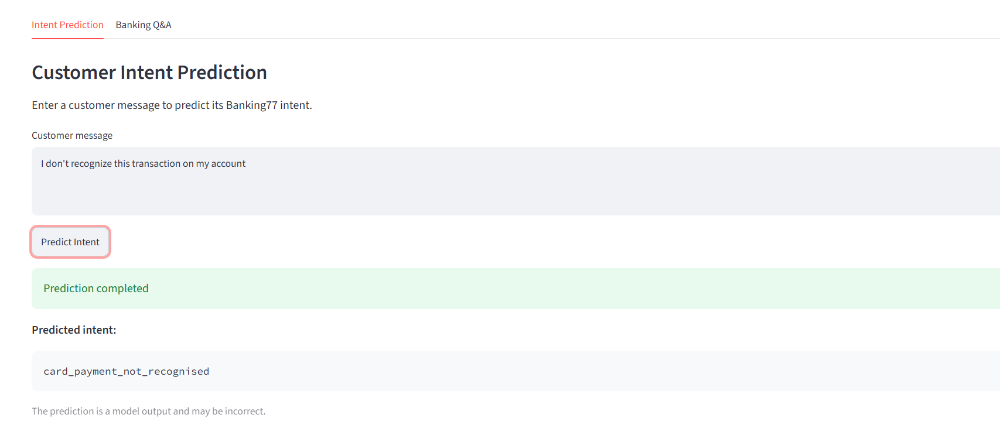
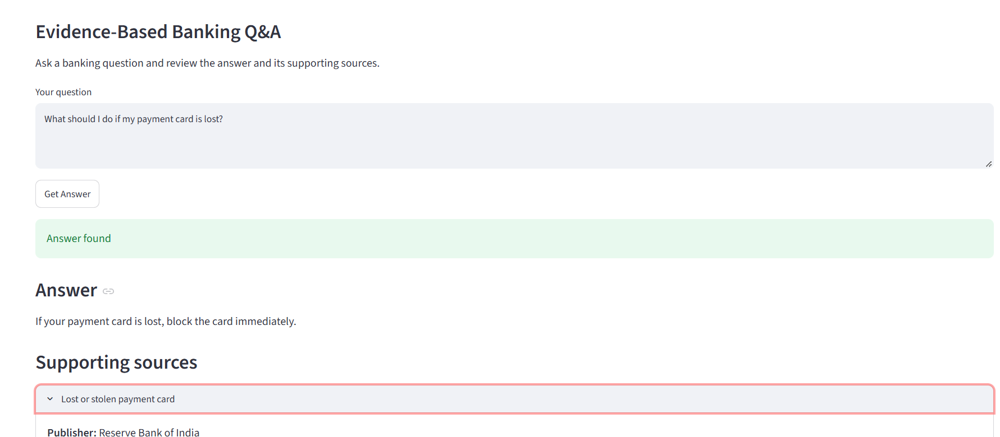
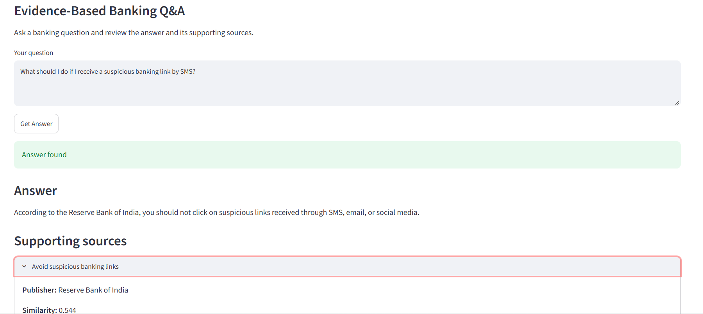
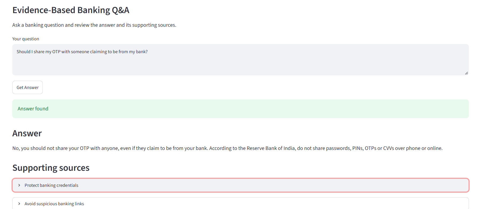
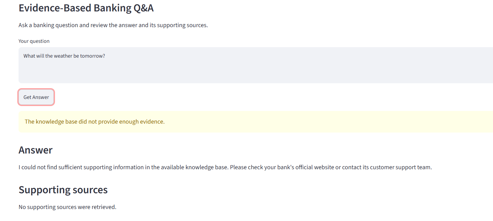

# Banking Customer Intelligence

An end-to-end banking NLP application combining **intent classification, semantic search, and evidence-based banking question answering** using Python, Scikit-learn, Sentence Transformers, FAISS, LangChain, LangGraph, Ollama, FastAPI, and Streamlit.

## Application Screenshots

### 1. Main Application



### 2. Banking Intent Prediction

The application predicts the intent of a customer message using a trained TF-IDF and LinearSVC pipeline.









### 3. Evidence-Based Banking Question Answering

The application retrieves relevant banking guidance and generates answers using the retrieved context, with supporting sources where available.









## Project Overview

Banking customers ask questions about card payments, cash withdrawals, money transfers, account access, transaction fees, and other banking services. This project demonstrates how NLP and machine learning can help categorize customer messages and retrieve relevant banking information.

The application implements two main workflows:

1. **Intent classification:** Predicts the customer's intent from a text message using the Banking77 dataset.
2. **Banking question answering:** Retrieves relevant guidance from a knowledge base and uses a language model to generate a context-supported answer.

The project demonstrates an end-to-end workflow, from text analysis and model evaluation to semantic retrieval, API development, and a user-facing application.

## Key Features

### Intent Classification
- Uses the Banking77 dataset with 77 intent categories.
- Applies TF-IDF text vectorization.
- Uses LinearSVC for intent prediction.
- Saves the vectorizer and classifier together in a reusable Scikit-learn pipeline.

### Semantic Search
- Generates sentence embeddings with `sentence-transformers/all-MiniLM-L6-v2`.
- Uses FAISS for similarity search.
- Normalizes embeddings and uses inner-product similarity for retrieval.
- Retrieves relevant documents from a banking guidance knowledge base.

### Retrieval-Augmented Question Answering
- Retrieves documents relevant to a customer's question.
- Integrates LangChain and LangGraph into the answer workflow.
- Uses Ollama for local language-model integration.
- Presents answers with supporting sources where available.

### Application and API
- Streamlit user interface.
- FastAPI backend.
- Pydantic request and response schemas.
- Pytest-based API tests.

## Technology Stack

| Component | Technologies |
|---|---|
| Language | Python |
| Data analysis | Pandas, NumPy |
| Text classification | Scikit-learn, TF-IDF, LinearSVC |
| Sentence embeddings | Sentence Transformers |
| Vector search | FAISS |
| RAG workflow | LangChain, LangGraph |
| Language model integration | Ollama |
| Backend API | FastAPI |
| Data validation | Pydantic |
| Frontend | Streamlit |
| Testing | Pytest |
| Version control | Git, GitHub |

## System Architecture

### Intent Classification Workflow

```text
Customer Message
       |
       v
Text Preprocessing
       |
       v
TF-IDF Vectorization
       |
       v
LinearSVC Classifier
       |
       v
Predicted Banking Intent
```

### Banking Question-Answering Workflow

```text
Customer Question
       |
       v
Sentence Transformer
       |
       v
Query Embedding
       |
       v
FAISS Similarity Search
       |
       v
Relevant Banking Documents
       |
       v
LangChain / LangGraph Workflow
       |
       v
Ollama Language Model
       |
       v
Answer with Supporting Sources
```

## Model Performance

The intent classifier was evaluated using cross-validation on the training data and the official Banking77 test set.

| Metric | Result |
|---|---:|
| Cross-validation macro F1 | 0.8813 |
| Cross-validation standard deviation | 0.0032 |
| Official test accuracy | 0.8948 |
| Official test macro F1 | 0.8947 |
| Official test weighted F1 | 0.8947 |

The classifier achieved approximately **89.48% accuracy** on the official test set.

The saved model artifact contains the TF-IDF vectorizer and LinearSVC classifier in one pipeline, allowing the same text transformation to be applied during inference.

The official test set was reserved for final evaluation rather than model tuning.

## Dataset and Knowledge Base

### Banking77

Banking77 provides labeled banking customer-service queries across 77 intent categories. It is used to train and evaluate the intent classifier.

### Banking Guidance Documents

A separate collection of banking guidance documents supports semantic retrieval and question answering. Synthetic test documents are excluded from the production retrieval index.

## Project Structure

```text
banking-customer-intelligence/
├── app.py
├── config/
├── data/
│   ├── raw/
│   └── processed/
├── docs/
├── models/
├── notebooks/
├── scripts/
│   └── inspect_models.py
├── screenshots/
│   ├── main_screen.png
│   ├── intent_predict_01.png
│   ├── intent_predict_02.png
│   ├── intent_predict_03.png
│   ├── intent_predict_04.png
│   ├── banking_qa_01.png
│   ├── banking_qa_02.png
│   ├── banking_qa_03.png
│   └── banking_qa_04.png
├── src/
│   ├── api/
│   │   ├── __init__.py
│   │   ├── main.py
│   │   └── schemas.py
│   └── components/
│       └── intent_prediction.py
├── tests/
│   └── test_api.py
├── .gitignore
├── requirements.txt
├── setup.py
└── README.md
```

This is a high-level overview. Additional configuration and source files may exist in the repository.

## Installation and Setup

### Prerequisites

- Python 3.11
- Git
- Ollama installed with a compatible language model for the question-answering workflow

### 1. Clone the Repository

```bash
git clone https://github.com/suvarna03/banking-customer-intelligence.git
cd banking-customer-intelligence
```

### 2. Create a Virtual Environment

On Windows PowerShell:

```powershell
python -m venv .venv
.\.venv\Scripts\Activate.ps1
```

### 3. Install Dependencies

```powershell
python -m pip install --upgrade pip
pip install -r requirements.txt
```

### 4. Prepare Required Resources

Ensure the trained intent-classification model, retrieval index, knowledge-base documents, and Ollama model are available and configured as required by the project.

Follow any additional instructions in the `docs/` directory and project configuration files.

## Running the Application

### Start Streamlit

From the project root:

```powershell
streamlit run app.py
```

Open the local URL displayed in the terminal.

### Start FastAPI

In a separate terminal, activate the virtual environment and run:

```powershell
uvicorn src.api.main:app --reload
```

Open the API documentation at:

`http://127.0.0.1:8000/docs`

The API and Streamlit application may depend on locally available model files, the knowledge base, and the Ollama service.

## API Capabilities

The FastAPI backend supports the following capabilities:

- Health check.
- Banking intent prediction.
- Banking question answering.

For the exact endpoint paths, request formats, and response schemas, refer to `src/api/main.py` and `src/api/schemas.py`, or inspect the interactive API documentation at `/docs` when the server is running.

## Testing

Run the automated tests with:

```powershell
python -m pytest tests -v
```

The current test suite covers:

- Health-check endpoint.
- Intent prediction endpoint.
- Banking question-answering endpoint.
- Validation of an empty intent message.

**Latest recorded test result:** Four API tests passed.

## Responsible Use and Limitations

- This is a portfolio demonstration, not a production banking system.
- Intent predictions may be incorrect, especially for ambiguous or closely related categories.
- Generated answers should be verified against the retrieved sources.
- The application does not access customer bank accounts or perform financial transactions.
- Banking guidance may become outdated and should be checked against current official sources.
- Avoid entering personal banking information, account numbers, passwords, or confidential customer data.
- Production use would require additional security, privacy, monitoring, evaluation, and reliability controls.

## Future Improvements

- Detailed per-intent precision, recall, and F1 analysis.
- Retrieval evaluation using a labeled banking-question dataset.
- Confidence analysis and classification error reporting.
- Stronger answer-grounding and source-attribution checks.
- Structured logging and monitoring.
- Automated testing through a CI pipeline.
- Deployment to a suitable hosting platform.
- Authentication, rate limiting, and production security controls.

## Author

**Suvarna Gawali**

- GitHub: [suvarna03](https://github.com/suvarna03)
- Project repository: [Banking Customer Intelligence](https://github.com/suvarna03/banking-customer-intelligence)
